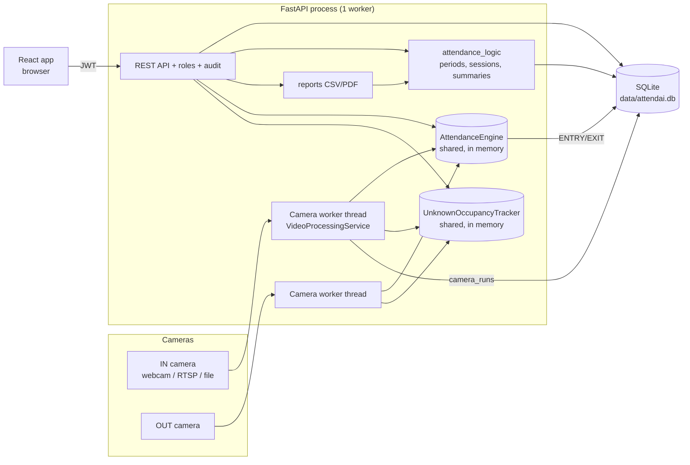
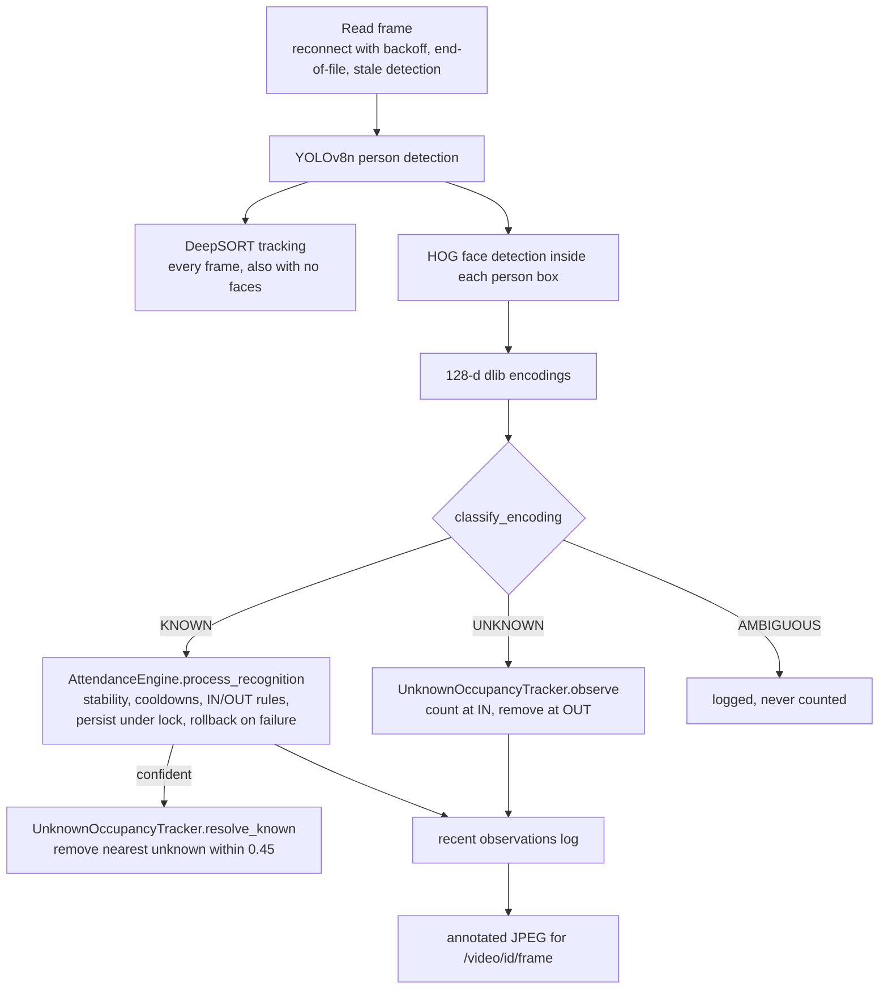
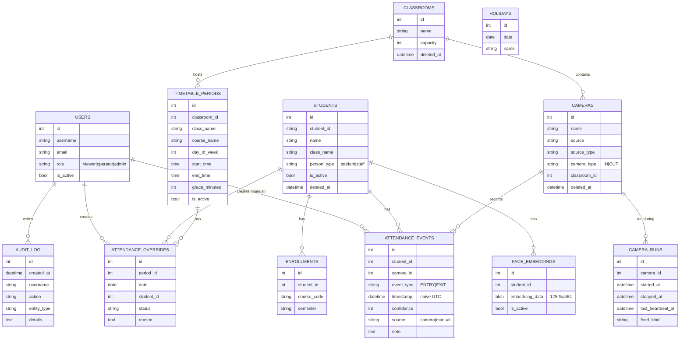

# Architecture

A modular monolith on one machine: one FastAPI process (one worker) runs the API and one background thread per
running camera; SQLite stores records; the React app is static files talking to the API over HTTP.

## System

## Per-frame pipeline (`app/services.py`)

Classification (`FaceDetectionService.classify_encoding`): for each enrolled person take the closest encoding;
best distance > tolerance → UNKNOWN; a different person also within tolerance and within the ambiguity margin →
AMBIGUOUS; otherwise KNOWN with score (1 − distance) × 100. Nobody enrolled → UNKNOWN.

Attendance rules (`AttendanceEngine`): per student a state machine OUTSIDE → ENTRY (IN camera) → INSIDE → EXIT (OUT
camera, after minimum presence). Recognitions must repeat on consecutive frames; gaps reset the count. One engine
and one tracker are shared by all cameras, so IN and OUT see the same state and two cameras cannot both record
the same entry. On start the engine is re-seeded from the last 24 h of stored events (restart safety).

## Data model

- Students, cameras and classrooms are soft-deleted so history stays intact; periods are deactivated.
- `attendance_events.timestamp` is written by SQLite (`CURRENT_TIMESTAMP`, naive UTC); day boundaries are the
  server's local days (`crud.local_day_start_utc`, `timestamp_at_or_after`).
- `camera_runs` records when cameras actually ran, so a missing entry during an uncovered period is reported
  as *Unverified*, not *Absent*.
- Not persisted on purpose: unregistered-person encodings and counts (memory only), photos (never stored).

## API overview

Interactive documentation with every schema: `http://127.0.0.1:8000/docs`. All endpoints except `/health`,
`/auth/login` and `/auth/register` need `Authorization: Bearer <token>`.

| Prefix | Purpose | Minimum role for writes |
|---|---|---|
| `/auth` | login (form), register (viewer), `me` | – |
| `/users` | accounts, roles, audit log | admin (also for reads) |
| `/students` | people CRUD, filters, `/classes`, `/import` (CSV, dry run), `/import/template` | operator (delete: admin) |
| `/face-enrollment` | enroll photo, list/erase face records | operator |
| `/cameras` | CRUD, toggle, `/{id}/test` | admin (test: operator) |
| `/video` | `/{id}/start`, `/{id}/stop`, `/{id}/status`, `/{id}/frame`, `/{id}/observations`, `/sessions`, `/live` | operator |
| `/attendance` | events (inclusive local date range), `/recent`, `/sessions`, `/manual` | operator (`POST /`, PUT, DELETE: admin) |
| `/timetable` | classrooms, periods, holidays, `/periods/{id}/attendance`, overrides, `/daily`, `/monthly` | admin (overrides: operator) |
| `/dashboard` | `/`, `/stats`, `/daily/{n}`, `/trend`, `/alerts` | – (read only) |
| `/reports` | `sessions.csv/.pdf`, `period.csv`, `daily.csv/.pdf`, `monthly.csv/.pdf` | – (read only) |
| `/enrollment` | course enrollments | operator |

## Frontend

`frontend/src`: `App.js` (routes), `components/Layout.js` (sidebar shell, health chip), `theme.js` (design
tokens), `components/ui.js` (shared page parts), `data.js` (the single axios client: token, 401 handling,
downloads), `context/AuthContext.js` (session, roles), one file per page in `pages/`. Polling intervals are
cleared on unmount; frames are fetched one at a time as blobs and their object URLs released.

## Scaling notes

Measured on the development laptop (CPU only, no GPU): see
[TESTING_AND_EVALUATION.md](TESTING_AND_EVALUATION.md#performance). Face matching is a linear scan
(~1.7 ms per face for 500 people × 3 photos), which is not the bottleneck; detection is. For ~500 students in
5 classrooms (10 cameras) on one machine expect to need a GPU or a lower processing rate per camera, measured on
the target hardware. SQLite is adequate for one process with one writer at a time; move to PostgreSQL only if
several backend processes are required (the in-memory engine/tracker would then need to move to a shared store).
